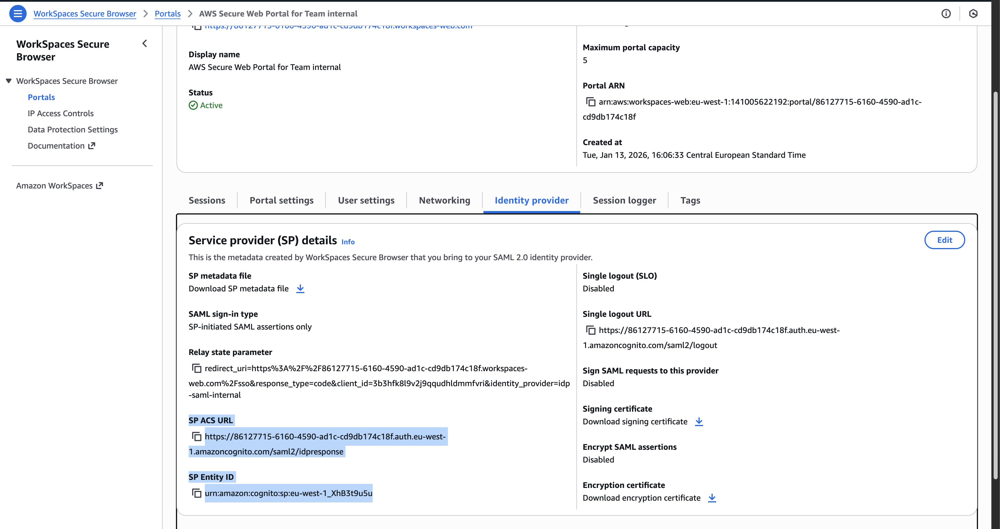
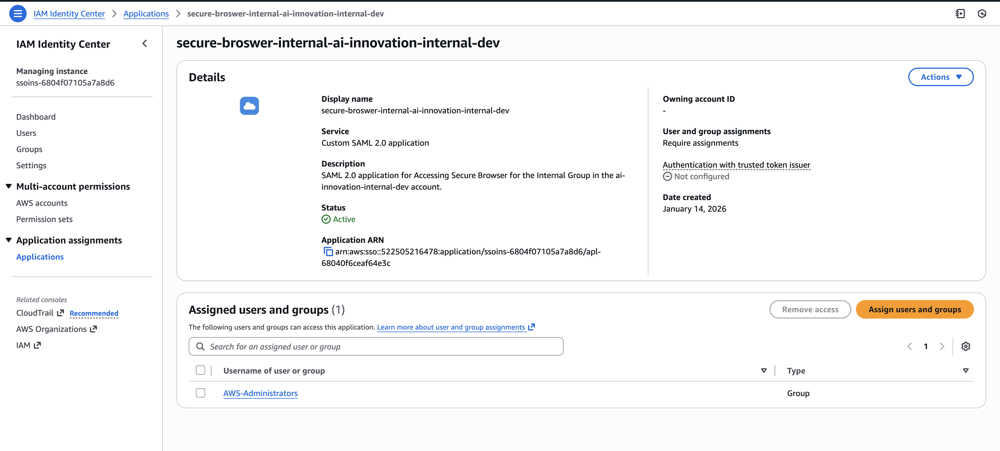
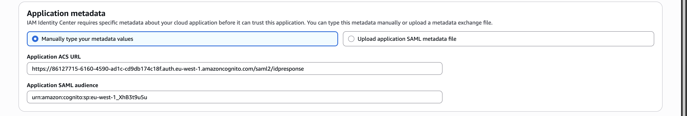
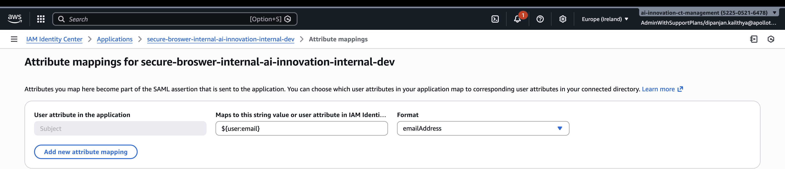

This ReadMe describes the use of AWS WorkSpaces Secure Browser as a single entry point for private Web applications on AWS.

# Benefits of Secure Browser over VPN

Traditional VPNs grant a device "network-level" access, which creates a significant attack surface. Secure Browser shifts 
the security boundary from the network to the application layer.

| Feature                      | VPN Approach                                      | Secure Browser Approach                                                   |
|------------------------------|---------------------------------------------------|---------------------------------------------------------------------------|
| Data Residency               | Data is downloaded to the local device.           | Zero Data at Rest. Only encrypted pixels are streamed.                    |
| Browser Behaviour Management | User browsers are outside of our control.         | Managed Browser can be fully configured e.g. no upload / download allowed |
| Auditability                 | Offers session logging and management.            | Offers session logging and management.                                    |
| Device Security              | Requires managed devices & security agents.       | BYOD Friendly. Securely works on any unmanaged Chrome/Edge.               |              
| Network Risk                 | Risk of lateral movement if device is compromised | Network Isolation. Sessions are isolated in disposable containers.        |
| User Experience              | Requires client software & constant re-auth.      | Clientless. Access via a simple URL with SSO.                             |          
| Maintenance                  | Complex patch management for VPN concentrators.   | Fully Managed. AWS handles all browser patching/scaling.                  |

# User Flow

The following flow describes the seamless experience for an end-user accessing an internal resource from a member account.

* Initiation: User navigates to the Secure Browser Portal URL in their local browser (Edge/Chrome).
* Authentication: The portal redirects the user to the Central AWS IdC Access Portal.
* Validation: User logs in with corporate credentials (and MFA). AWS IdC verifies their membership in the Secure Browser Access Group.
* SAML Handshake: IdC sends a SAML assertion back to the Member Account portal containing the user's email.
* Provisioning: AWS spins up a disposable, hardened Chrome container in the Member Account VPC.
* Secure Access: The remote browser connects to internal VPC resources (over ports 80, 443) and streams the visual output to the user.

# Integration of AWS IAM Identity Center (Cross-Account)

In an AWS Control Tower environment, the Identity Center (IdP) and the Secure Browser (SP) typically reside in different accounts. 
This requires a SAML 2.0 Federation:

* Service Provider (SP): The WorkSpaces Web Portal in the Member Account. It provides the ACS URL and Audience URI.
* Identity Provider (IdP): A "Customer Managed Application" created in the Central IdC Account. It consumes the SP details and provides the Metadata XML.
* The Bridge: The `aws_workspacesweb_identity_provider` resource in Terraform links these two by uploading the IdP Metadata into the Portal.

# Team Isolation

We will create a shared secure browser instance in every region. This will be shared by every TPO group.

1. Create a Secure Browser Portal in the `ai-innovation-internal-dev` account in the workload VPC and private subnets
2. Create a Customer Managed Identity Center SAML Application
3. Associate the relevant Identity Center Groups with the SAML Application
5. Configure the Secure Browser Portal to use the SAML application mentioned above as Identity Provider

The result is that only members of the group will be able to access the Secure Browser.

# Step by Step Instructions

## 1. Create a Secure Browser Portal

Do this by calling the [secure-browser](./../../../modules/secure-browser) module e,g, in [main.tf](./main.tf). Omit the 
`idp_saml_metadata_xml`, this needs to be filled in later.

Once the terraform code is applied, note down the ACS URL and Entity ID from the Secure Browser Web Portal in AWS Console:

## Create a Customer Managed Identity Center SAML Application 

This is a manual step as there is no terraform equivalent. In the management account, create a new "SAML 2.0 Application."
in AWS IAM Identity Center.

Set the ACS URL and Audience to the ACS URL and Entity ID from the previous step.

Add the following attribute mapping

## Create an Identity Center Group with the users who will need access to the private web application(s)

This has to be implemented in the [aws-org-management](./https://github.com/atl-ai-innovation/aws-org-management) repository.

## Associate the Identity Center Group with the SAML Application

Same as above. See https://github.com/atl-ai-innovation/aws-org-management/pull/139.

## Configure the Secure Browser Portal to use the SAML application mentioned above as Identity Provider

Download the IDP Metadata file from the SAML Application and copy it to the [idp-metadata](./idp-metadata) directory.
Now add the contents of this file as the `idp_saml_metadata_xml` input variable to the `secure-browser` module call.

After this, open the Portal EndPoint URL from your browser. This is ask the user to sign in and will open the secure browser session.

